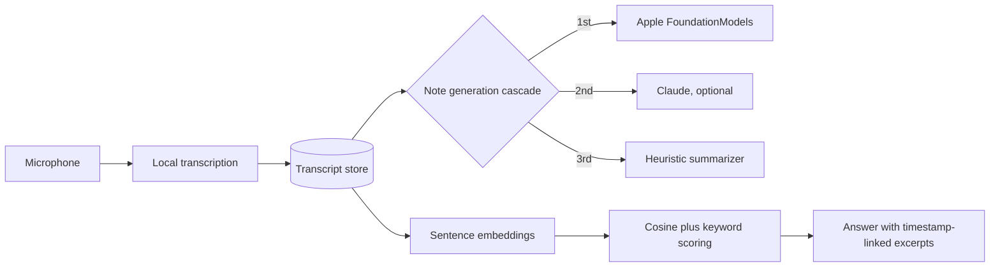

# Cadence: On-Device Meeting Note-Taker for iOS

Cadence records meetings and produces transcripts, structured notes, decisions and action items, with local transcription so audio does not have to leave the phone. Answers to questions about past meetings link back to the exact moment in the transcript.

**Status:** in development (source-backed prototype; no users or adoption are claimed).

> Source code is private. This repository is a README-only architecture write-up. Happy to walk through the code live: [adk08644@gmail.com](mailto:adk08644@gmail.com).

## Problem

Meeting AI usually means sending audio to a cloud service and trusting a summary you cannot check. Cadence runs transcription locally and makes every answer verifiable against the source.

## What it does

- Local, on-device transcription in 14 languages
- Structured meeting notes: summary, decisions, action items
- Question answering over meeting transcripts with timestamp-linked source excerpts

## Architecture

## Key engineering decisions

**Retrieval you can check.** Retrieval over meeting transcripts uses sentence embeddings with hybrid cosine-similarity and keyword scoring, and returns excerpts linked to timestamps, so each answer can be verified against the original conversation.

**Three-engine note generation.** Notes try Apple's on-device FoundationModels first, optionally use Claude, and fall back to a heuristic engine, so every user gets a result even without a capable device or a key.

## Tech stack

Swift, SwiftUI, FoundationModels, Claude API, sentence embeddings, on-device speech recognition.
