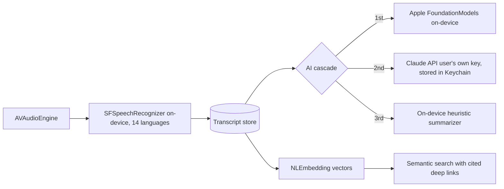

# Cadence — On-Device AI Meeting Note-Taker for iOS

**Unlimited free meeting transcription, because the AI runs on the phone.**

> Commercial product. **The source code is private.**
> This write-up covers the design of the app.

---

## What it does

Cadence records meetings and produces live transcripts, structured summaries, decisions, and action items — with the defining constraint that **transcription runs entirely on-device** (SFSpeechRecognizer + AVAudioEngine, 14 Apple-supported languages). Zero per-minute cloud cost is what makes unlimited free recording economically possible; it is also a privacy feature: audio never has to leave the phone.

**Feature highlights**

- Live on-device transcription in 14 Apple-supported languages
- Structured AI summaries: decisions, action items, follow-up drafts
- **Cross-meeting semantic search** with source-cited deep links back to the exact moment in a transcript
- Widgets, Live Activity / Dynamic Island while recording, Siri App Intents
- StoreKit 2 subscriptions

## Architecture

### Architecture notes

**A three-engine AI cascade instead of a hard dependency.** Summarization tries Apple's on-device FoundationModels first (free, private), falls back to Claude using the **user's own API key stored in the Keychain** (the app ships no server and no secrets), and finally falls back to an on-device heuristic engine. Every user gets a result; better hardware or a personal key gets a better one. There is no backend to operate, which is itself an architectural choice: zero server cost, zero server attack surface.

**Search that cites its sources.** Cross-meeting search embeds transcript segments with NLEmbedding and returns results that deep-link to the exact timestamp in the exact meeting, so every answer can be checked against the original conversation.

**Native platform depth.** Live Activities and Dynamic Island during recording, home-screen widgets, and Siri App Intents make the recorder reachable without opening the app — the feature set of a native platform app rather than a webview wrapper.

## Stack

| Layer | Technology |
|---|---|
| App | Swift, SwiftUI, SwiftData |
| Speech | SFSpeechRecognizer, AVAudioEngine (on-device) |
| AI | Apple Intelligence (FoundationModels), Claude API (BYO key), heuristic fallback |
| Search | NLEmbedding vector similarity |
| Platform | WidgetKit, Live Activities, App Intents, StoreKit 2 |
